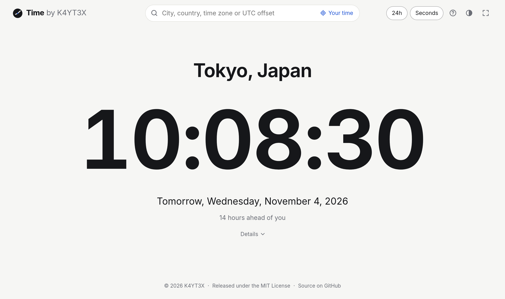

# Time

The exact time in any time zone, city or UTC offset, at [time.k4yt3x.com](https://time.k4yt3x.com).
A static site on GitHub Pages: everything runs in the browser.

<picture>
  <source media="(prefers-color-scheme: dark)" srcset=".github/screenshots/dark.png" />
  
</picture>

## Addresses

The path names the clocks to show. Commas separate several, shown side by side:
`/Tokyo,London,UTC+5:30`. The root shows your own time zone. Any spelling below is rewritten to
the one in brackets.

| Kind                     | Examples                                                                                                |
| ------------------------ | ------------------------------------------------------------------------------------------------------- |
| UTC offset               | `/utc+2` `/utc+02` `/utc+5:30` `/utc+0530` `/utc+5.5` `/gmt-3` `/gmt8` `/+5:30` (`/UTC+5:30`, `/UTC-3`) |
| Abbreviation             | `/est` `/PT` `/cest` `/ist` `/aoe` (`/EST`, `/AoE`)                                                     |
| City                     | `/tokyo` `/new york` `/sao paulo` `/nyc` `/calcutta` (`/New_York`, `/Kolkata`)                          |
| Country, state, province | `/japan` `/usa` `/uk` `/california` `/ontario` (`/United_States`)                                       |
| IANA time zone           | `/asia/tokyo` `/America/Argentina/Buenos_Aires` `/Etc/GMT+3` (`/Asia/Tokyo`, `/UTC-3`)                  |

Offsets run from UTC−12 to UTC+14 in whole minutes. A decimal is a fraction of an hour when it
is a quarter, a half or three quarters (`5.5` is 5:30); otherwise the dot separates hours from
minutes (`5.45` is 5:45). Abbreviations for standard or daylight time (`EST`, `CEST`) are fixed
offsets; generic ones (`ET`, `PT`, `AET`) follow daylight saving time.

GitHub Pages has no server-side routing: a path without a file is answered with `404.html`,
which the build makes a copy of the app. Clock pages therefore load with HTTP status 404, and
the app writes the address in its canonical form with `history.replaceState`.

## Keyboard

Typing anywhere on the page starts a search. `/` goes to the search box, `Home` back to your own
time zone, and `?` opens the help, which shows all this in the site itself. Full screen is the
browser's own (`F11`) or the button in the header.

## Accuracy

The clock does not trust the device's. It reads [Akamai's time service](https://time.akamai.com/?ms)
a few times and works out the device's error the way NTP does, to within a few milliseconds.
Where that service cannot be reached, it falls back on the `Date` header of the site's own
server, which has whole seconds only, timing its requests to narrow the error to about the
network round trip. It measures again every 30 minutes, and at once when the device's clock jumps.

## Development

Node 26 or later.

```sh
npm install
npm run dev        # development server
npm run check      # lint, typecheck, unit tests
npm run test:e2e   # end-to-end tests in Chromium and Firefox, against the production build
npm run build      # dist/
npm run preview    # serve dist/ as GitHub Pages would, on port 4318
```

Set `CHROMIUM_PATH` to use a system Chromium where Playwright's own build is not installed.

Time zone rules come from the browser. The names of zones, their countries and old names come
from the IANA time zone database, extracted into `src/data/tzdb.json`. To update it to a new
release, run `npm run tzdb` (or `npm run tzdb -- 2026f` for a given one) and commit the result.

## Deployment

Pushing to `master` runs the checks and deploys to GitHub Pages
(`.github/workflows/deploy.yml`). The repository's Pages source must be "GitHub Actions", with
the custom domain set there; the DNS record is a `CNAME` from `time` to `k4yt3x.github.io`.

## License

[MIT](LICENSE). The build lists the licenses of the libraries and fonts it includes in
`licenses.md`, served at `/licenses.md`.
